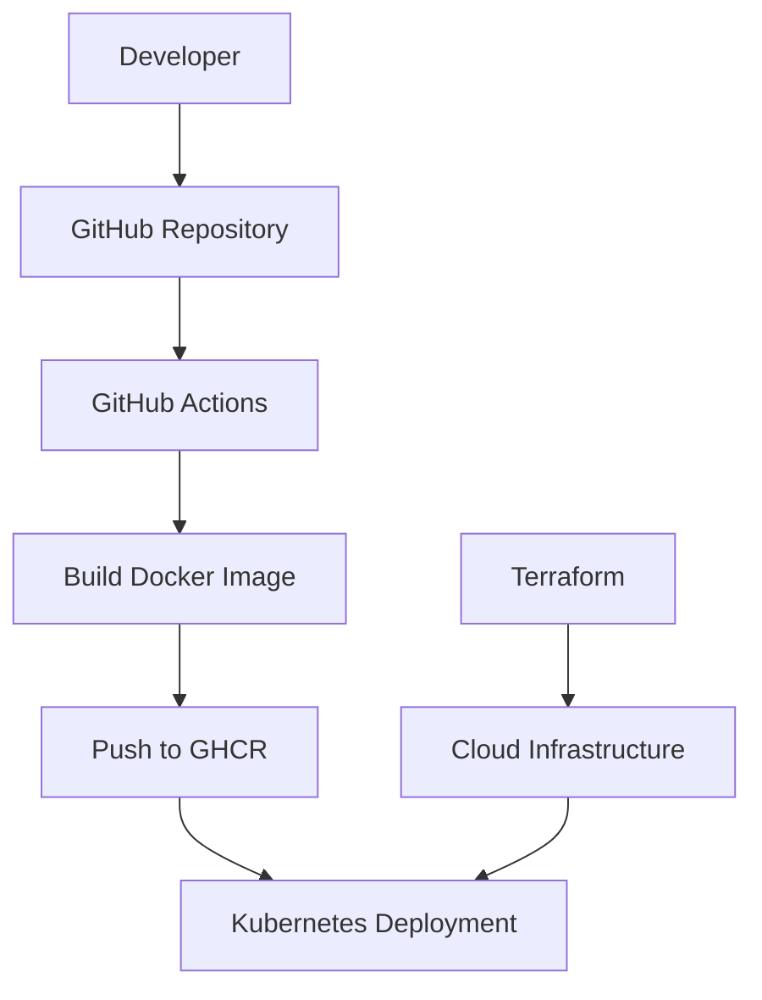
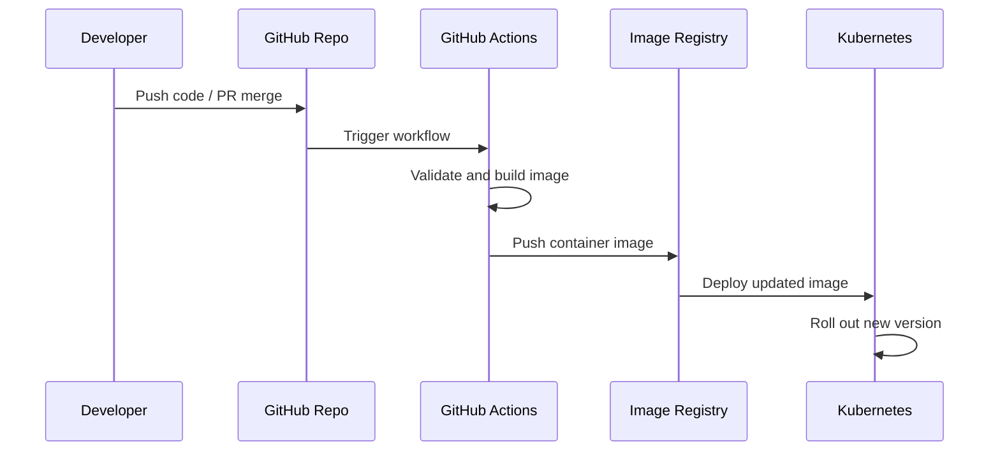

# AutoNetOps DevOps Starter Kit

This repository is a clean DevOps starter package focused on containerization, automation, and deployment workflows.

It is designed to help you understand how an application can be packaged, tested, containerized, and deployed in a professional environment using Docker, Kubernetes, Terraform, and GitHub Actions.

---

## Project purpose

This repo does not rely on a heavy custom backend service. Instead, it is intentionally lightweight and production-friendly so you can:

- run the service locally with Docker Compose
- build container images with Docker
- deploy to Kubernetes
- manage cloud resources with Terraform
- automate CI/CD through GitHub Actions

---

## Architecture overview



---

## What you need to run this project

Install these tools on your machine:

- Git
- Docker Desktop or Docker Engine
- Docker Compose plugin
- Make
- Optional: kubectl for cluster deployment
- Optional: Terraform for infra provisioning
- Optional: AWS CLI / cloud credentials for Terraform

### Recommended environment

- OS: Windows 10/11, macOS, or Linux
- CPU: 2 cores or more
- RAM: 4 GB or more
- Internet access for pulling Docker images

---

## Local setup

### 1. Clone the repository

```bash
git clone https://github.com/mohddilshadkhan2003/DevOps_02.git
cd DevOps_02
```

### 2. Build the app image

```bash
make build
```

### 3. Run the service locally

```bash
make run
```

Or directly:

```bash
docker compose -f autonetops-devops/docker/docker-compose.yml up --build
```

### 4. Access the service

Open:

```text
http://localhost:8000
```

### 5. Stop the service

```bash
docker compose -f autonetops-devops/docker/docker-compose.yml down
```

---

## Workflow diagram



---

## Common commands

```bash
make build
make run
make tf-init
make tf-plan
make k8s-apply
```

---

## Kubernetes deployment

```bash
kubectl apply -f autonetops-devops/k8s/
```

Check deployment health:

```bash
kubectl rollout status deployment/autonetops-backend
```

---

## Terraform usage

```bash
make tf-init
make tf-plan
```

If cloud access is required, configure AWS credentials first:

```bash
export AWS_ACCESS_KEY_ID=your-key
export AWS_SECRET_ACCESS_KEY=your-secret
```

---

## Important note

This is not a traditional backend-heavy application repository. It is a DevOps deployment starter that focuses on the service lifecycle, deployment automation, and infrastructure workflows. The goal is a clean and professional operational setup.

---

## Troubleshooting

- If Docker does not start, verify Docker Desktop or the Docker service.
- If port 8000 is already in use, change APP_PORT in your environment.
- If Kubernetes deployment fails, check your kubeconfig and cluster access.
- If Terraform fails, confirm your AWS credentials and run `terraform init` again.

---

## Final takeaway

This project is a strong, professional starting point for learning and demonstrating DevOps practices without adding unnecessary backend complexity.

