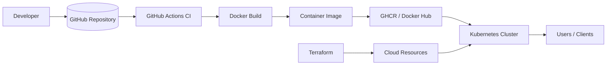
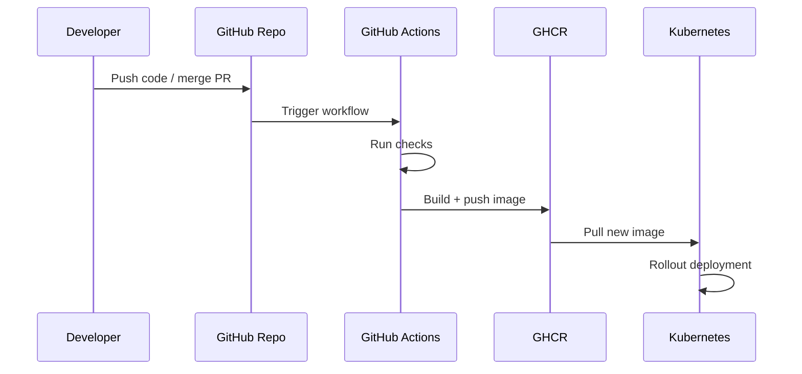

# AutoNetOps DevOps Starter Kit

A practical DevOps starter project for packaging, running, and deploying a Python-based service with Docker, Kubernetes, Terraform, and GitHub Actions.

This repository is designed as a clean infrastructure and CI/CD foundation. It helps you understand how an application can be containerized, promoted through staging, and deployed with automation without needing a large custom backend setup.

[](https://github.com/mohddilshadkhan2003/DevOps_02/actions)
[](https://ghcr.io)
[](./LICENSE)

---

## Overview

This project focuses on the operational side of software delivery:

- Containerization with Docker
- Local orchestration with Docker Compose
- Kubernetes deployment manifests
- Terraform infrastructure examples
- GitHub Actions automation
- Lightweight deployment scripts

The goal is to make the project easy to understand, easy to run, and professional enough to use as a starter for real-world deployments.

---

## High-level architecture



---

## Workflow

1. Developer pushes code or infrastructure changes.
2. GitHub Actions runs CI checks.
3. Docker image is built and validated.
4. The image is published to GHCR or Docker Hub.
5. Kubernetes applies the deployment manifests.
6. Terraform provisions or manages required cloud resources.

This creates a professional workflow for a small service-based project without introducing unnecessary complexity.

---

## Repository structure

```text
autonetops-devops/
├── .github/workflows/   # CI and publish automation
├── docker/               # Dockerfile and Compose setup
├── k8s/                  # Kubernetes Deployment and Service manifests
├── scripts/              # Shell helper scripts
├── terraform/            # Example Terraform configuration
├── Makefile              # Common commands
├── README.md             # Project documentation
├── LICENSE               # License
├── CONTRIBUTING.md        # Contribution guidelines
└── CODE_OF_CONDUCT.md    # Community standards
```

---

## What you need on your system

Before running this project locally, install the following:

- Git
- Docker Desktop or Docker Engine
- Docker Compose plugin
- Make
- Optional: kubectl
- Optional: Terraform
- Optional: AWS CLI / cloud credentials if using Terraform

### Recommended versions

- Docker: 24+ or newer
- Docker Compose: v2+
- Git: 2.30+
- Python: 3.11 (used by the container image)

---

## Run locally

### 1. Clone the repository

```bash
git clone https://github.com/mohddilshadkhan2003/DevOps_02.git
cd DevOps_02
```

### 2. Build the image

```bash
make build
```

### 3. Run the service with Docker Compose

```bash
make run
```

Or directly:

```bash
docker compose -f autonetops-devops/docker/docker-compose.yml up --build
```

The service is exposed on:

```text
http://localhost:8000
```

### 4. Stop the service

```bash
docker compose -f autonetops-devops/docker/docker-compose.yml down
```

---

## Useful Make targets

```bash
make build      # build container image
make run        # start local environment
make tf-init    # initialize terraform
make tf-plan    # preview terraform changes
make k8s-apply  # apply Kubernetes manifests
```

---

## Kubernetes deployment

To deploy the service to a cluster:

```bash
kubectl apply -f autonetops-devops/k8s/
```

Check rollout status:

```bash
kubectl rollout status deployment/autonetops-backend
```

---

## Terraform setup

If you want to work with Terraform:

```bash
make tf-init
make tf-plan
```

Set AWS credentials if needed:

```bash
export AWS_ACCESS_KEY_ID=your-key
export AWS_SECRET_ACCESS_KEY=your-secret
```

---

## Deployment flow



---

## Notes

- This repository is a DevOps starter kit and infrastructure template.
- It is focused on delivery automation rather than a custom business backend.
- The setup is intentionally lightweight and clean so it is easy to adapt to real projects.
- No extra backend service is required for the deployment flow described here.

---

## Troubleshooting

### Docker permission issues

Ensure Docker Desktop is running, or your Linux user is in the docker group.

### Port already in use

Change the app port using an environment variable:

```bash
APP_PORT=8080 docker compose -f autonetops-devops/docker/docker-compose.yml up --build
```

### Kubernetes connection errors

Verify your cluster context:

```bash
kubectl config current-context
kubectl get nodes
```

### Terraform errors

Check provider credentials and initialize the project again:

```bash
make tf-init
```

---

## License

This project is licensed under the MIT License.

